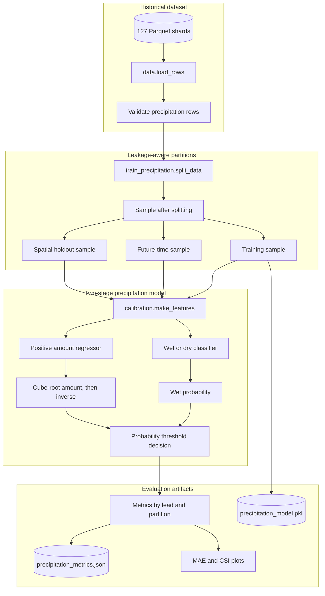
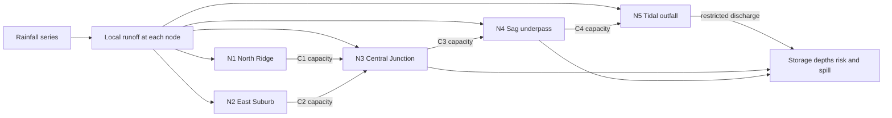
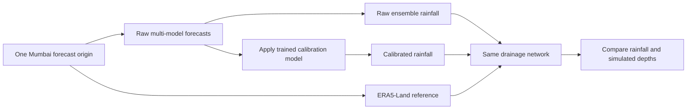
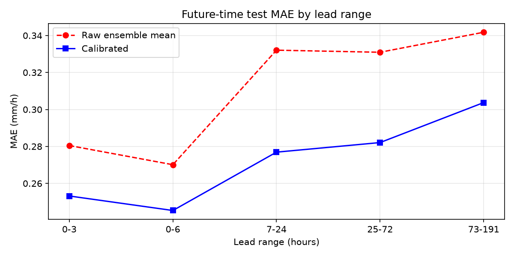
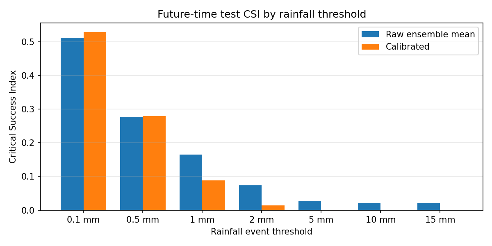
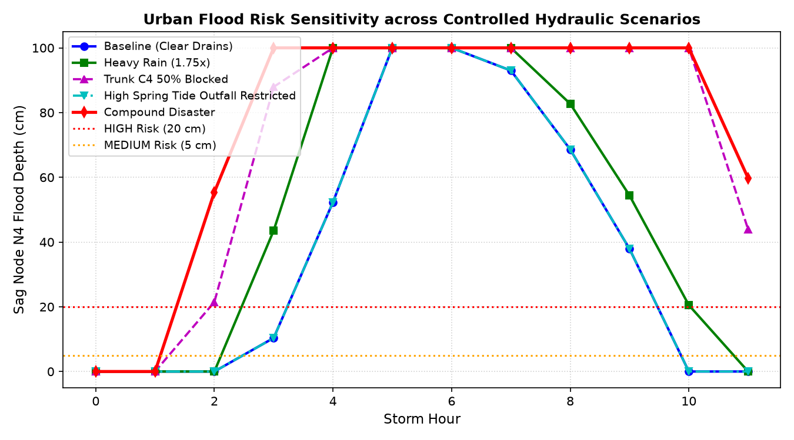
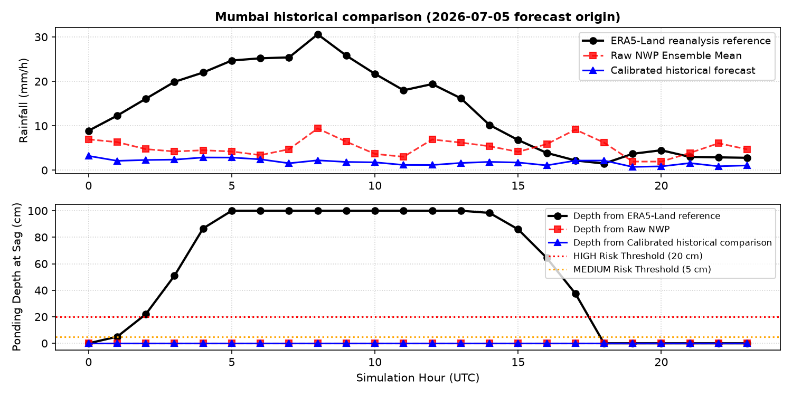

# Urban Flood Nowcasting System (SIH26085)

> [!NOTE]
> A **reproducible research prototype** for precipitation calibration and
> config-driven urban-drainage scenarios.

## Contents

- [Urban Flood Nowcasting System (SIH26085)](#urban-flood-nowcasting-system-sih26085)
  - [Contents](#contents)
  - [Project at a glance](#project-at-a-glance)
  - [Capstone and SIH problem context](#capstone-and-sih-problem-context)
  - [Dataset and provenance](#dataset-and-provenance)
  - [Implementation diagrams](#implementation-diagrams)
    - [Precipitation calibration and evaluation](#precipitation-calibration-and-evaluation)
    - [Configured drainage network](#configured-drainage-network)
    - [Illustrative historical comparison](#illustrative-historical-comparison)
  - [Implemented scope and gaps](#implemented-scope-and-gaps)
  - [Reproduce from PowerShell](#reproduce-from-powershell)
  - [Results](#results)
  - [Dashboard and scenario figures](#dashboard-and-scenario-figures)
    - [Precipitation evaluation](#precipitation-evaluation)
    - [Drainage scenarios](#drainage-scenarios)
    - [Illustrative Mumbai historical comparison](#illustrative-mumbai-historical-comparison)
  - [Limitations](#limitations)
  - [Project documentation](#project-documentation)

## Project at a glance

This repository contains two explicitly separate demonstrations:

1. **Precipitation calibration:** a Model Output Statistics (MOS) model trained
   on multi-model historical NWP forecasts and evaluated against ERA5-Land.
2. **Drainage demonstration:** a config-driven rainfall/runoff/
   drainage model with an offline scenario dashboard.

> [!IMPORTANT]
> The dataset audit covers **9,582,912 rows**. Training and evaluation use
> deterministic samples taken *after* chronological and spatial partitions
> are defined. Exact boundaries and counts are saved in
> [`outputs/precipitation_metrics.json`](outputs/precipitation_metrics.json).

## Capstone and SIH problem context

This is a **capstone prototype** addressing the urban-flood challenge that the
project configuration identifies as **SIH26085**, in the Disaster Management
theme. The SIH 2026 working brief supplied with this request describes the
intended system: couple short-lead rainfall forecasts with urban drainage
models to estimate flood-prone locations, timing, and severity, and provide
decision support.

The brief identifies itself as a working draft and asks readers to verify
details against the [official SIH problem-statement portal](https://sih.gov.in/sih2026PS).
I could not independently confirm the exact SIH26085 entry in the portal's
publicly readable listing. Treat the ID and detailed scope here as the supplied
brief/configuration's attribution, and confirm the final statement with the
team's SIH record before submission.

This repository implements selected rainfall-calibration and drainage
components of the broader capstone goal.

## Dataset and provenance

The precipitation experiment uses the
[WeatherGPT D1 MOS dataset on Hugging Face](https://huggingface.co/datasets/Arko007/weathergpt-d1-mos-dataset),
also present in [`weathergpt-d1-mos-dataset/`](weathergpt-d1-mos-dataset/).
According to its dataset card, it contains **9,582,912 rows** across **127
Indian locations**, with hourly historical forecasts from GFS, ECMWF, ICON,
and GEM and ERA5-Land reference values. The listed period is 2025-08-01 through
2026-08-28, with forecast leads of 0–191 hours. The dataset card attributes
the forecast and reanalysis data to Open-Meteo's historical-forecast API and
ERA5-Land archive.

Please retain attribution and follow the dataset card's
[CC BY 4.0 license](https://creativecommons.org/licenses/by/4.0/) when
redistributing or publishing derived work. The exact data checks and known
gaps are documented in [docs/data-inventory.md](docs/data-inventory.md).

## Implementation diagrams

These diagrams follow the repository's current code paths.

### Precipitation calibration and evaluation

<!-- mermaid-checked: no \n, no em-dash/en-dash, no {} in labels, subgraphs are id["label"], arrows are -->|"label"|, all subgraphs closed by end, ids unique -->


`split_data` separates complete forecast-origin cycles and held-out locations
before `sample_frame` caps partition sizes. The trained model is a wet/dry
classifier plus a regressor trained on wet rows; it is **not** a radar echo
extrapolation model. Main code: [`scripts/train_precipitation.py`](scripts/train_precipitation.py),
[`src/floodnowcast/data.py`](src/floodnowcast/data.py), and
[`src/floodnowcast/calibration.py`](src/floodnowcast/calibration.py).

### Configured drainage network

<!-- mermaid-checked: no \n, no em-dash/en-dash, no {} in labels, subgraphs are id["label"], arrows are -->|"label"|, all subgraphs closed by end, ids unique -->


`CoupledDrainageSystem` in
[`src/floodnowcast/drainage.py`](src/floodnowcast/drainage.py) computes runoff
at each node, routes inflows through the configured directed conduits, then
tracks bounded surface storage, spill, outfall discharge, and accounting
checks. Network geometry is defined in [`config.yaml`](config.yaml).

### Illustrative historical comparison

<!-- mermaid-checked: no \n, no em-dash/en-dash, no {} in labels, subgraphs are id["label"], arrows are -->|"label"|, all subgraphs closed by end, ids unique -->


This comparison uses contiguous lead hours from one historical forecast
origin. All three rainfall sequences are passed through the same drainage
model. See [`scripts/run_flood_demo.py`](scripts/run_flood_demo.py).

## Implemented scope and gaps

The table compares the supplied SIH brief's intended capabilities with the
current code, rather than implying that every challenge requirement is already
delivered.

| SIH brief capability | What this repository does | Status |
|---|---|---|
| Ingest live IMD radar, satellite QPE, and gauge data | Trains/evaluates on a downloaded historical NWP/ERA5-Land dataset; no live ingestion | **Not implemented** |
| Produce fine-resolution 0–6 h rainfall nowcasts | Calibrates tabular NWP precipitation and reports lead-time metrics, including 0–6 h; no radar extrapolation or fine-grid nowcast | **Partial** |
| Model real municipal drainage assets | Runs Manning-capacity calculations on a five-node, four-conduit network configured in [`config.yaml`](config.yaml) | **Config-driven demonstration** |
| Couple rainfall, runoff, and drainage | Routes rainfall scenarios and an illustrative historical comparison through the configured network | **Prototype** |
| Map street/ward inundation and time-to-flood | Shows node-level scenario depths and risk in a self-contained HTML dashboard | **Partial** |
| Send location-specific alerts and recommended actions | No SMS, mobile alerts, live feeds, or operational decision workflow | **Not implemented** |
| Validate and transfer across cities | Tests accounting and sensitivity properties; evaluates rainfall on temporal/spatial holdouts, but has no observed flood labels or multi-city hydraulic validation | **Partial** |
| Address missing infrastructure data and planning needs | Documents data gaps and compares blockage/tide scenarios; no crowdsourcing, sensor integration, or planning report | **Not implemented** |

Relevant implementation is in [`scripts/train_precipitation.py`](scripts/train_precipitation.py),
[`src/floodnowcast/calibration.py`](src/floodnowcast/calibration.py),
[`src/floodnowcast/drainage.py`](src/floodnowcast/drainage.py),
[`scripts/run_flood_demo.py`](scripts/run_flood_demo.py), and
[`scripts/make_dashboard.py`](scripts/make_dashboard.py).

## Reproduce from PowerShell

Run these commands from the repository root:

```powershell
.\.venv\Scripts\python.exe -m pip install -r requirements.txt
.\.venv\Scripts\python.exe scripts\audit_dataset.py
.\.venv\Scripts\python.exe scripts\train_precipitation.py --max-rows 150000
.\.venv\Scripts\python.exe scripts\run_flood_demo.py
.\.venv\Scripts\python.exe scripts\make_dashboard.py
.\.venv\Scripts\python.exe -m unittest discover -s tests -v
```

The training script writes [`outputs/precipitation_model.pkl`](outputs/precipitation_model.pkl),
including the model, feature names, wet threshold, probability threshold, and
seed.

> [!CAUTION]
> The Mumbai output is an *illustrative historical comparison* using one
> forecast origin (`2026-07-05 00:00 UTC`) and contiguous lead hours; it is not
> a nowcast.

## Results

The following table is regenerated from
[`outputs/precipitation_metrics.json`](outputs/precipitation_metrics.json).
Values are **MAE in mm/h**; each row states its lead range.

| Partition | Lead range | Raw ensemble MAE | Calibrated MAE |
|---|---:|---:|---:|
| Future-time, seen locations | 0–3 h | 0.280480 | 0.253196 |
| Future-time, seen locations | 0–6 h | 0.270110 | 0.245346 |
| Future-time, seen locations | 7–24 h | 0.332061 | 0.276907 |
| Future-time, seen locations | 25–72 h | 0.330934 | 0.282092 |
| Future-time, seen locations | 73–191 h | 0.341755 | 0.303710 |
| Spatial holdout | 0–3 h | 0.140818 | 0.130039 |
| Spatial holdout | 0–6 h | 0.140385 | 0.131860 |
| Spatial holdout | 7–24 h | 0.175780 | 0.152575 |
| Spatial holdout | 25–72 h | 0.179158 | 0.158564 |
| Spatial holdout | 73–191 h | 0.187604 | 0.169035 |

These metrics use the 0.1 mm wet threshold and 0.5 probability decision
threshold. The forecast-origin split cutoff is `2026-05-01 00:00 UTC`. The
full JSON also contains individual NWP baselines, climatology, RMSE, bias,
CSI, Brier score, sample counts, and boundaries.

## Dashboard and scenario figures

The generated [interactive dashboard](outputs/index.html) is self-contained
and can be opened locally in a browser. It includes the network visualization,
scenario selector, and available evaluation figures.

### Precipitation evaluation





### Drainage scenarios



### Illustrative Mumbai historical comparison



The rainfall plots report model evaluation against ERA5-Land; the drainage
plots show simulation outputs from the configured network.

## Limitations

- No live radar, gauge, or satellite QPE ingestion.
- Drainage network geometry, invert levels, and ponding areas are config-driven
  (no municipal GIS assets).
- ERA5-Land is a reanalysis reference, not independent rain-gauge truth.
- Drainage solver uses full-flow Manning capacities, instant routing, and a
  finite surface-storage cap.
- No observed street-flood labels or multi-city hydraulic validation.

## Project documentation

- [System architecture](docs/architecture.md)
- [Methodology and mathematical formulation](docs/methodology.md)
- [Dataset inventory](docs/data-inventory.md)
